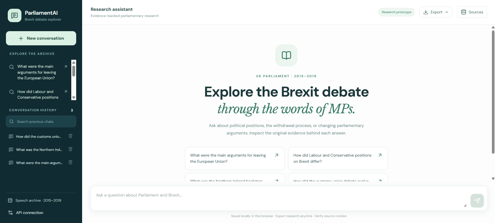
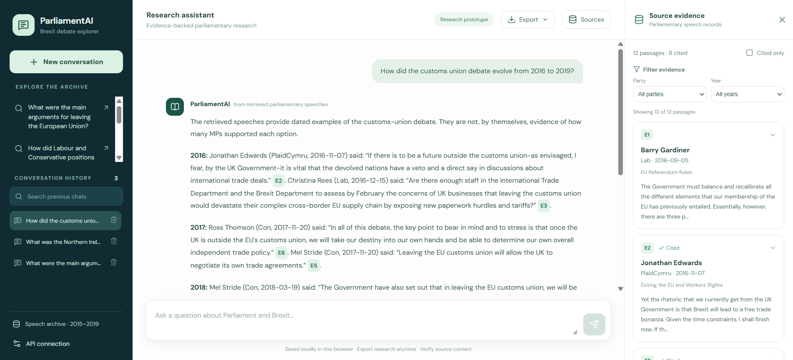
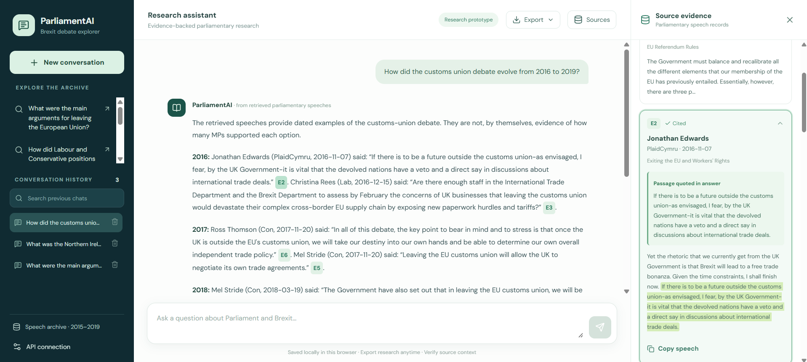

# ParliamentAI: GraphRAG for UK Parliamentary Brexit Debates

An evidence-backed research application for exploring parliamentary Brexit debates, built with Python, NetworkX, ChromaDB, FastAPI and React.

The project began as an MSc Data Science investigation into whether graph-guided retrieval improves multi-hop question answering compared with a strong hybrid RAG baseline. It was subsequently extended into **ParliamentAI**, a full-stack application that lets users ask questions, inspect parliamentary speech evidence, filter sources and export research conversations.

The original benchmark and interactive application are related but distinct: the benchmark evaluates retrieval approaches, while ParliamentAI demonstrates an integrated research workflow.

## Application preview



| Grounded answer | Source inspection |
|---|---|
|  |  |

[View the complete screenshot gallery](docs/SCREENSHOT_GALLERY.md)

## Project overview

| Component | Technology |
|---|---|
| Knowledge graph | NetworkX |
| Vector database | ChromaDB |
| Embeddings | BAAI/bge-small-en-v1.5 |
| Retrieval | Dense, lexical, graph-guided and reranked retrieval |
| Backend | Python, FastAPI |
| Frontend | React, Vite |
| Local LLM experiments | Ollama |
| Evaluation | Retrieval, answer quality, faithfulness and diversity metrics |

**Original research experiment**

- 39,423 Brexit-related parliamentary speeches
- 201,131 indexed text chunks
- Knowledge graph with 1,806 nodes and 42,634 edges
- 50 evaluation questions across three reasoning-complexity levels
- Comparison of hybrid RAG with graph-guided retrieval

The preprocessing script is configured to accept records dated 2015-01-01 through 2020-12-31; this is a **filtering window, not a claim that source records exist in every year**. The available ParlSpeech V2 UK corpus extends to 2019, and the interactive ParliamentAI service explicitly supports questions about 2015–2019. See [data provenance and preparation](data/README.md) for the difference between the published source format and the prepared CSV archive expected by this repository.

## ParliamentAI application

The interactive application supports:

- Natural-language questions about parliamentary Brexit debates
- Answers with numbered evidence references such as `[E1]`
- Supporting speeches with speaker, party, date and debate metadata
- Citation navigation from answers to original retrieved passages
- Party, year and cited-only evidence filters
- Browser-local persistent conversation history
- Searchable previous conversations
- Copying answers and source passages
- Markdown and JSON exports
- JSON backup of saved conversations

The frontend communicates with the FastAPI endpoint:

`POST /graphrag/ask`

The older `/ask` route is a placeholder and is not used by ParliamentAI.

### Application architecture

```text
React frontend
    |
    | POST /graphrag/ask
    v
FastAPI
    |
    v
GraphRAG service
    |
    +-- Question-aware and temporal retrieval
    |
    +-- ChromaDB vector retrieval
    |
    +-- NetworkX graph guidance
    |
    +-- Cross-encoder reranking
    |
    +-- Grounded answer generation
    |
    v
Answer + numbered evidence passages
    |
    v
React citations, source filters,
conversation history and exports
```

See [Architecture](docs/ARCHITECTURE.md) for further detail.

## Research motivation

Conventional vector retrieval can work well when a question is answered by one directly relevant passage. Parliamentary questions are often more complicated.

Questions may require:

- Comparing different political parties
- Connecting statements from several MPs
- Following arguments across multiple debates
- Identifying changes over time
- Retrieving evidence spanning different parliamentary topics

The research question was whether explicit graph relationships could improve retrieval for these more complex tasks.

Importantly, the comparison used a competitive hybrid baseline rather than vector search alone.

## Data preparation

The preprocessing pipeline filters ParlSpeech V2 House of Commons material for Brexit-related content, normalises speaker names, removes procedural and very short records, and deduplicates exact speech text.

Speeches are segmented into overlapping, sentence-aware chunks and embedded with `BAAI/bge-small-en-v1.5`.

These embeddings are stored in ChromaDB with speaker, party, date and debate metadata.

The full data and persistent vector database are not committed to GitHub. A sample and benchmark questions are available in `data/`.

## Knowledge graph

The graph is constructed programmatically with NetworkX.

It uses four primary node categories:

- **SPEAKER**
- **PARTY**
- **TOPIC**
- **YEAR**

Its relationships include speaker-party membership, topic participation, topic-year discussion and repeated participation in the same debates.

The graph also retains frequency statistics and aggregate TextBlob sentiment values. Sentiment is a general text-polarity measure, **not a reliable label for an MP's Brexit stance**.

The graph is not generated by an LLM.

## Retrieval systems

### Hybrid RAG baseline

The experimental baseline combines dense search, HyDE, BM25, party-aware retrieval and temporal retrieval, followed by reciprocal-rank fusion and cross-encoder reranking.

### GraphRAG

The graph-guided approach uses extracted speaker, party and year information, semantic topic matching, graph traversal, relevant-speaker identification and graph-assisted candidate retrieval.

The current application additionally uses question-aware evidence selection and dedicated handling for explicitly temporal questions.

The application defaults to an extractive grounded-answer mode that keeps responses tied to retrieved parliamentary passages.

See [Methodology](docs/METHODOLOGY.md) for the original experimental design.

## Original research evaluation

The benchmark contains 50 questions:

- 14 one-hop questions
- 17 two-hop questions
- 19 three-hop questions

The following are results from the **original offline research experiment**, not an independent evaluation of every version of the current React application.

| Metric | Hybrid RAG | GraphRAG |
|---|---:|---:|
| MRR | 0.725 | **0.762** |
| nDCG@5 | 0.801 | **0.818** |
| BERTScore | **0.799** | 0.786 |
| NLI faithfulness | 0.114 | **0.122** |
| Answer relevancy | **0.590** | 0.538 |
| Context precision | 0.446 | **0.462** |
| Speaker diversity | 4.14 | **4.98** |

GraphRAG was numerically higher on five of seven metrics.

The most clearly supported GraphRAG advantage was **speaker diversity**, with a paired Wilcoxon test giving `p < 0.001`. The hybrid baseline performed better on BERTScore, with `p ≈ 0.008`.

Average improvements in MRR and nDCG@5 were not statistically significant in this 50-question evaluation.

MRR and nDCG@5 use an entity-based relevance proxy rather than independent human-labelled passage relevance. Reference answers were generated from pooled evidence, not human-written ground truth.

The findings indicate trade-offs rather than universal superiority of GraphRAG.

For additional analysis, see [Evaluation Results](results/RESULTS.md).

## Application validation

The current application has undergone the following checks:

| Check | Observed result |
|---|---|
| Backend structural acceptance suite | 8/8 passed |
| FastAPI contract tests | 5/5 passed |
| Conversation history interactions | 6/6 passed |
| Export interactions | 5/5 passed |
| Frontend ESLint | Passed without reported issues |
| Frontend production build | Passed |
| Production-dependency npm audit | 0 reported vulnerabilities |

The eight backend acceptance checks focus on evidence coverage, citation integrity and structural behaviour. They **do not prove complete historical accuracy**.

The FastAPI contract tests mock the expensive GraphRAG service. They verify route and response behaviour, not retrieval relevance or answer quality.

Some historical summaries may be incomplete or may describe an objection raised by another speaker as though it were the speaker's own position. Users should consult the original cited passage before relying on an interpretation.

## Repository structure

```text
graphrag-uk-parliament/
├── app/                # FastAPI and grounded retrieval service
├── src/                # Original research pipeline and GraphRAG engines
├── frontend/           # React/Vite research interface
├── docker/             # Backend image and runtime dependencies
├── compose.yaml        # Local Docker Compose deployment
├── tests/              # Maintained API contract tests
├── data/               # Public sample, benchmark and data instructions
├── results/            # Curated original evaluation results
├── figures/            # Research evaluation figures
├── scripts/            # Research utilities
├── docs/               # Methodology, architecture and reproducibility
├── requirements.txt
├── .gitignore
├── LICENSE
└── README.md
```

## CI, Docker and application preview

[](https://github.com/RonitBulani/graphrag-uk-parliament/actions/workflows/ci.yml)
[](https://github.com/RonitBulani/graphrag-uk-parliament/actions/workflows/docker-build.yml)

GitHub Actions checks Python syntax and five lightweight FastAPI contract tests, React lint and production build, a production-dependency audit, and reproducible builds of the backend and frontend Docker images. The Docker workflow runs when relevant application or Docker files change. These jobs deliberately do **not** download the entire speech corpus, start the full retrieval service or independently verify historical accuracy.

The local Docker deployment was built and manually tested with the full retrieval artifacts. The frontend loaded, real GraphRAG requests returned responses and speech evidence could be inspected. The complete dataset and generated retrieval indexes are **not** included in the repository or built into the images.

See the [authentic screenshot gallery](docs/SCREENSHOT_GALLERY.md), [local demonstration guide](docs/DEMO.md) and [Docker setup instructions](DOCKER_SETUP.md). No publicly hosted demo or video recording is claimed.

## Running ParliamentAI locally

### Requirements

- Python 3.12
- Node.js and npm compatible with the installed Vite version
- The full preprocessed parliamentary corpus and generated graph/vector artifacts for the complete backend
- Sufficient memory and storage for the local retrieval models

Clone the repository and create a Python environment:

```powershell
git clone https://github.com/RonitBulani/graphrag-uk-parliament.git
cd graphrag-uk-parliament

python -m venv .venv
.\.venv\Scripts\Activate.ps1

python -m pip install -r requirements.txt
```

The public repository does not include the complete data and indexes. Build or supply them following [Reproducibility](docs/REPRODUCIBILITY.md).

Start FastAPI:

```powershell
$env:GRAPHRAG_ENABLE_R2 = "0"
$env:GRAPHRAG_GENERATION_MODE = "extractive"
$env:GRAPHRAG_NLI_ENABLED = "0"

python -m uvicorn app.main:app --host 127.0.0.1 --port 8000
```

Start React in another terminal:

```powershell
cd frontend
npm.cmd ci
npm.cmd run dev
```

Open `http://127.0.0.1:5173/`.

The interactive frontend uses the `/graphrag/ask` endpoint.

### Alternative: run with Docker Compose

Docker runs the React/Nginx frontend and FastAPI backend in separate containers, with the original research data excluded from images. The complete ChromaDB vector store, knowledge graph and metadata must already exist locally; copying them into the Docker runtime directory is a separate, one-time preparation step.

From the repository root, stop any local FastAPI process accessing the original ChromaDB database. If `data/docker_runtime` does not already exist:

```powershell
.\scripts\prepare_docker_data.ps1
```

Then run:

```powershell
docker compose config --quiet
docker compose build
docker compose up -d
docker compose ps
```

Once the backend reports healthy, open `http://localhost:8080`. The backend health endpoint is `http://localhost:8080/backend/health`. To stop without deleting the model cache, run `docker compose down`. See [Docker setup](DOCKER_SETUP.md) for prerequisites, data protection and troubleshooting.

This is a **local-only** setup: port 8080 is bound to loopback, and the Docker images are built locally or in CI rather than published to a container registry.

### Frontend checks

```powershell
cd frontend
npm.cmd run lint
npm.cmd run build
npm.cmd audit --omit=dev
```

At the time of the release preparation, the production-dependency audit reported no vulnerabilities. A separate development-dependency `picomatch` advisory was still under review.

## Reproducing the original experiment

The original offline workflow consists of:

```text
01_data_loading.py
02_vectorisation.py
03_knowledge_graph.py
04_naive_rag.py
05_graphrag.py
06_generate_pooled_references.py
07_evaluation.py
```

The full corpus must first be acquired from its source. Some stages are computationally expensive and can rebuild existing generated artifacts.

For model preparation, dataset paths, execution order and reproducibility limitations, see [Reproducibility](docs/REPRODUCIBILITY.md).

## Limitations

- The full ParlSpeech corpus and generated ChromaDB index are not included in the repository.
- The original benchmark contains only 50 questions.
- Pooled references are generated rather than independently human-annotated.
- Entity-based retrieval metrics do not constitute passage-level relevance judgements.
- Sentiment polarity does not establish political stance.
- Correctly numbered citations do not guarantee that the interpretation is correct.
- Saved conversations are stored in the current browser, not a shared backend database.
- Conversation export is supported; importing a backup is not yet implemented.
- Deployment hardening, public hosting and broader security review remain future work.

## Author

Ronit Bulani

MSc Data Science, Lancaster University

## Licence

The project code is released under the MIT Licence. Third-party datasets, parliamentary source material and model weights remain governed by their respective licences and terms.
