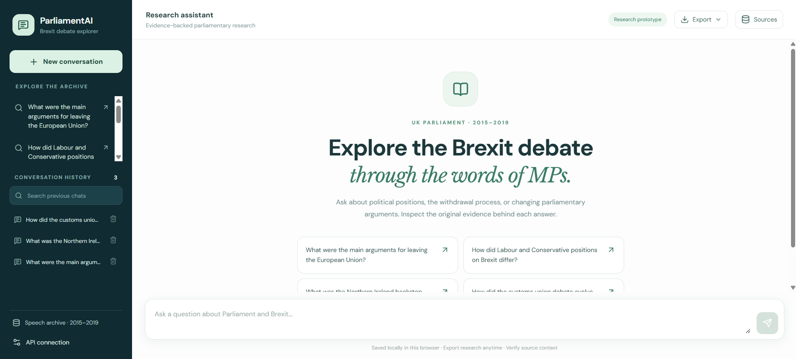
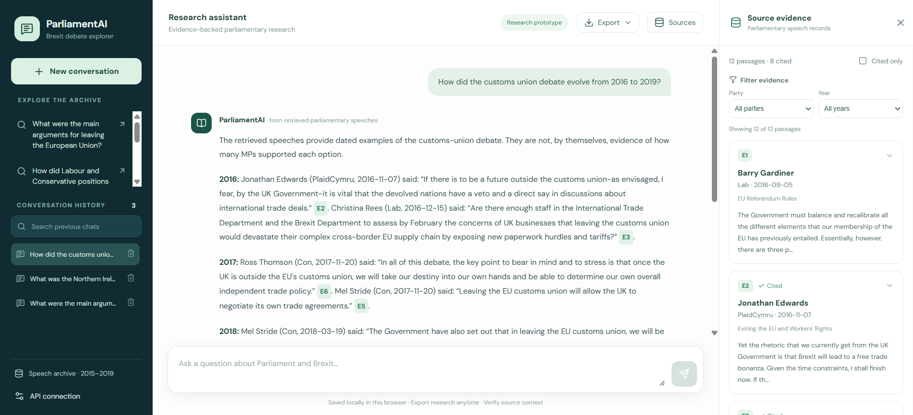
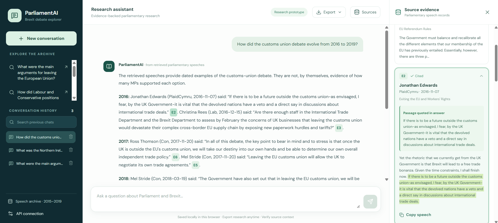
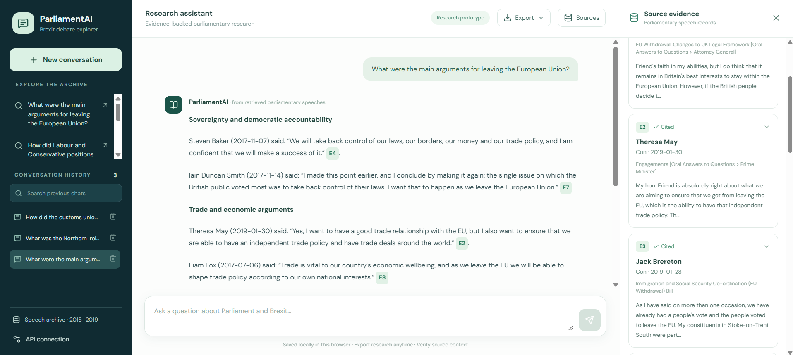
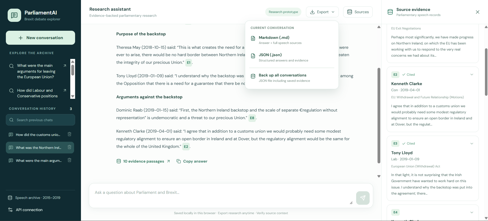

# ParliamentAI screenshot gallery

These images were captured from the **running local ParliamentAI application**. They demonstrate the research workflow; they are not synthetic mockups or additional evaluation results.

## 1. Research workspace

The landing page brings together starter questions, a searchable conversation history, and the research question composer.

## 2. Grounded answer

An example customs-union query displays dated speech excerpts with numbered evidence references alongside the source panel.

## 3. Source inspection

Selecting a reference opens the corresponding speech passage, including speaker and party metadata, and highlights the quoted text.

## 4. Conversation history

Saved conversations can be reopened from the browser-local history. Evidence remains accessible when reviewing an earlier question.

## 5. Research exports

Research conversations can be exported as Markdown or JSON; the application can also back up its saved conversation history in JSON format.

## Interpretation and limitations

These screenshots show successful local UI interactions, not a verified historical benchmark. Evidence citations enable inspection but do not independently guarantee that a summary accurately represents every speaker's position. The full parliamentary corpus and persistent index are not included in the public repository.
